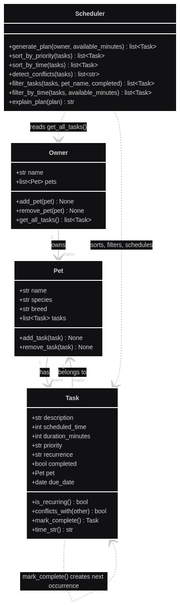

# PawPal+ (Module 2 Project)

**PawPal+**, a Streamlit app that helps a pet owner plan care tasks for their pet.

## Getting started

### Setup

```bash
python -m venv .venv
source .venv/bin/activate  # Windows: .venv\Scripts\activate
pip install -r requirements.txt
```

### Run the demo

```bash
# CLI demo (see sample output below)
python main.py

# Streamlit app
streamlit run app.py
```

## 📐 UML

`diagrams/uml_final.mmd` is the Mermaid class diagram for the final implementation (classes, attributes, methods, and relationships in `pawpal_system.py`), with `diagrams/uml.mmd` kept as the earlier draft for comparison.



## 🛠️ Implementation Summary

I built four classes in `pawpal_system.py`: Owner, Pet, Task, and Scheduler.

An Owner holds a list of Pets and gets every task across all of them with `get_all_tasks()`. A Pet holds its own list of Tasks and can add or remove them. A Task stores its description, scheduled time, duration, priority, recurrence, and completion status, and can check for time conflicts with another task.

The Scheduler is the brain: it pulls every pet's tasks via `owner.get_all_tasks()`, sorts by priority, then greedily fills a time budget until the available minutes run out. `explain_plan()` turns the result into a readable "Today's Schedule." `main.py` wires this together and prints it to the terminal.

## ✨ Features

- **Sorting by time** — `sort_by_time()` orders every pet's tasks earliest to latest, pushing anything with no scheduled time to the end.
- **Sorting by priority** — `sort_by_priority()` orders tasks high → medium → low for `generate_plan()`'s greedy pass.
- **Conflict warnings** — `detect_conflicts()` flags any two tasks that overlap in time on the same day, even across different pets, since one owner can't be in two places at once.
- **Daily/weekly recurrence** — `mark_complete()` on a recurring task auto-schedules its next occurrence a day or a week out, so recurring care never has to be re-entered by hand.
- **Filtering** — `filter_tasks()` narrows a task list by pet, completion status, or both.
- **Time-budgeted planning** — `generate_plan()` greedily fills a day's available minutes with the highest-priority tasks that still fit, and `explain_plan()` turns the result into a readable summary.

## 🖥️ Sample Output

`python main.py` walks through sorting, recurrence, and conflict detection end to end:

```
$ python main.py
All tasks (unsorted):
  Task('Evening walk', 18:00, high, due=2026-10-25)
  Task('Feeding', 09:00, medium, due=2026-10-25)
  Task('Cage cleaning', 10:00, low, due=2026-10-25)
  Task('Morning walk', 08:00, high, due=2026-10-25)
  Task('Vet checkup', 12:00, high, due=2026-10-25)
  Task('Evening feeding', 18:20, medium, due=2026-10-25)
  Task('Brushing', 20:00, low, due=2026-10-25)
  Task('Litter box cleaning', 11:00, medium, due=2026-10-25)

All tasks (after sort_by_time):
  Task('Morning walk', 08:00, high, due=2026-10-25)
  Task('Feeding', 09:00, medium, due=2026-10-25)
  Task('Cage cleaning', 10:00, low, due=2026-10-25)
  Task('Litter box cleaning', 11:00, medium, due=2026-10-25)
  Task('Vet checkup', 12:00, high, due=2026-10-25)
  Task('Evening walk', 18:00, high, due=2026-10-25)
  Task('Evening feeding', 18:20, medium, due=2026-10-25)
  Task('Brushing', 20:00, low, due=2026-10-25)

Marking tasks as done:
  Morning walk (Biscuit) -> done
  Feeding (Whiskers) -> done
  Cage cleaning (Clover) -> done

Completed tasks (filtered from sorted list):
  Task('Morning walk', 08:00, high, due=2026-10-25)
  Task('Feeding', 09:00, medium, due=2026-10-25)
  Task('Cage cleaning', 10:00, low, due=2026-10-25)

Next occurrences auto-scheduled from recurring tasks:
  Morning walk (Biscuit) -> Task('Morning walk', 08:00, high, due=2026-10-26)
  Feeding (Whiskers) -> Task('Feeding', 09:00, medium, due=2026-10-26)
  Cage cleaning (Clover) -> Task('Cage cleaning', 10:00, low, due=2026-11-01)

Conflict check:
  WARNING: Conflict: 'Evening walk' (Biscuit, 18:00) overlaps with 'Evening feeding' (Clover, 18:20)
  WARNING: Conflict: 'Grooming appointment' (Biscuit, 09:00) overlaps with 'Feeding' (Whiskers, 09:00)
```

## 🧪 Testing PawPal+

Run the full suite from the project root with:

```bash
python -m pytest
```

`tests/test_pawpal.py` covers the core behaviors the scheduler depends on:

- **Sorting correctness** — `sort_by_time()` returns tasks in chronological order, pushes tasks with no `scheduled_time` to the end, and handles an empty list without error.
- **Recurrence logic** — marking a `daily` task complete with `mark_complete()` schedules its next occurrence one day later, a `weekly` task schedules one week later, and a `none` task schedules nothing.
- **Conflict detection** — `detect_conflicts()` flags two tasks that overlap at the same time across different pets, but correctly leaves back-to-back tasks (one ending exactly when the next starts) and same-time tasks on different `due_date`s unflagged.
- A couple of baseline checks on `Task.mark_complete()` and `Pet.add_task()` from earlier in the project.

Sample test output:

```
$ python -m pytest -v
============================= test session starts ==============================
platform linux -- Python 3.12.3, pytest-9.1.1, pluggy-1.7.0
rootdir: /home/rizz/Documents/AI110/ai110-module2show-pawpal-starter
plugins: anyio-4.15.1
collected 12 items

tests/test_pawpal.py::test_mark_complete_changes_status PASSED           [  8%]
tests/test_pawpal.py::test_add_task_increases_pet_task_count PASSED      [ 16%]
tests/test_pawpal.py::test_sort_by_time_returns_chronological_order PASSED [ 25%]
tests/test_pawpal.py::test_sort_by_time_pushes_unscheduled_tasks_last PASSED [ 33%]
tests/test_pawpal.py::test_sort_by_time_handles_empty_list PASSED        [ 41%]
tests/test_pawpal.py::test_mark_complete_on_daily_task_schedules_next_day PASSED [ 50%]
tests/test_pawpal.py::test_mark_complete_on_weekly_task_schedules_next_week PASSED [ 58%]
tests/test_pawpal.py::test_mark_complete_on_non_recurring_task_schedules_nothing PASSED [ 66%]
tests/test_pawpal.py::test_detect_conflicts_flags_overlapping_tasks_same_time PASSED [ 75%]
tests/test_pawpal.py::test_detect_conflicts_ignores_back_to_back_tasks PASSED [ 83%]
tests/test_pawpal.py::test_detect_conflicts_ignores_same_time_on_different_due_dates PASSED [ 91%]
tests/test_pawpal.py::test_detect_conflicts_handles_empty_and_single_task_lists PASSED [100%]

============================== 12 passed in 0.02s ==============================
```

**Confidence Level: ⭐⭐⭐⭐☆ (4/5)**

All 12 tests pass, covering the three behaviors I was least sure about: unscheduled tasks in sorting, the due-date math in recurrence, and day-boundary handling in conflict detection. Not 5 stars because `generate_plan()` — the method that chains priority sorting with the time-budget filter — and the Streamlit UI aren't covered yet, so I can't vouch for how those pieces behave together.

## 📐 Smarter Scheduling

| Feature | Method(s) | Notes |
|---------|-----------|-------|
| Task sorting | `Scheduler.sort_by_time()`, `Scheduler.sort_by_priority()` | Sorts by scheduled time (earliest first) or priority (high to low) |
| Filtering | `Scheduler.filter_tasks()` | Filters by pet name, completion status, or both at once |
| Conflict handling | `Scheduler.detect_conflicts()`, `Task.conflicts_with()` | Flags overlapping time slots across all pets, same day |
| Recurring tasks | `Task.mark_complete()` | Auto-schedules the next occurrence for daily/weekly tasks |

**Task sorting.** `Scheduler.sort_by_time()` orders tasks earliest to latest using `scheduled_time`, pushing anything with no time set to the end. `sort_by_priority()` orders high to low priority. Neither one mutates the original list — both return a new sorted list, so calling them doesn't change `pet.tasks` or `owner.get_all_tasks()`.

**Filtering.** `Scheduler.filter_tasks(tasks, pet_name=None, completed=None)` returns only the tasks matching whichever filters you pass in. Leave `pet_name` or `completed` as `None` to skip that filter, or use both together to, say, get one pet's incomplete tasks in a single call.

**Conflict handling.** `Task.conflicts_with(other)` checks if two tasks overlap in time on the same `due_date`. `Scheduler.detect_conflicts(tasks)` runs that check pairwise across every task passed in, regardless of which pet they belong to, since one owner can't physically do two things at once. It never raises — it just returns a list of warning strings for the caller to print or act on.

**Recurring tasks.** Tasks have a `recurrence` field ("daily", "weekly", or "none") and a `due_date`. When `Task.mark_complete()` is called on a recurring task, it marks the task done and automatically creates the next occurrence as a new `Task` on the same pet, with `due_date` advanced by a day (daily) or a week (weekly), using `datetime.timedelta`.

## 📸 Demo Walkthrough

### What the UI lets you do

`app.py` is a Streamlit app with three sections:

- **Owner** — enter an owner name, which persists across reruns in `st.session_state`.
- **Add a Pet** — add a pet (name, species, breed); added pets show up in a table below the form.
- **Add a Task** — pick one of the owner's pets, then add a task (title, duration, priority, scheduled time). The full task list renders sorted by time, with conflict warnings shown right below it.
- **Build Schedule** — set the available minutes for the day and click "Generate schedule" to run `generate_plan()` across every pet the owner has, with its own conflict check and a "Why this plan?" explanation.

### Example workflow

1. Add a pet (e.g., Biscuit, a dog).
2. Add a second pet (e.g., Whiskers, a cat).
3. Add a task for Biscuit at 09:00 and a task for Whiskers also at 09:00 — the task table (sorted by `sort_by_time()`) shows both, and `detect_conflicts()` immediately flags the overlap with a warning.
4. Set "Available minutes today" and click "Generate schedule" — `generate_plan()` sorts by priority, greedily fills the time budget, and the resulting plan is displayed sorted by time, with its own conflict check and a readable explanation of why each task was chosen.

### Key Scheduler behaviors shown

- **Sorting** — both the task list and the generated plan are shown in chronological order via `sort_by_time()`, even though `generate_plan()` internally schedules by priority first.
- **Conflict warnings** — surfaced at two points: live, as soon as any two tasks overlap, and again specifically within whatever plan gets generated.
- **Recurrence** — demonstrated in `main.py` below rather than the UI, since the UI doesn't yet expose a "mark complete" button.

### Sample CLI output (`python main.py`)

`main.py` adds three pets with eight tasks out of chronological order, then walks through sorting, marking recurring tasks complete, filtering to completed tasks, and conflict detection:

```
$ python main.py
All tasks (unsorted):
  Task('Evening walk', 18:00, high, due=2026-10-25)
  Task('Feeding', 09:00, medium, due=2026-10-25)
  Task('Cage cleaning', 10:00, low, due=2026-10-25)
  Task('Morning walk', 08:00, high, due=2026-10-25)
  Task('Vet checkup', 12:00, high, due=2026-10-25)
  Task('Evening feeding', 18:20, medium, due=2026-10-25)
  Task('Brushing', 20:00, low, due=2026-10-25)
  Task('Litter box cleaning', 11:00, medium, due=2026-10-25)

All tasks (after sort_by_time):
  Task('Morning walk', 08:00, high, due=2026-10-25)
  Task('Feeding', 09:00, medium, due=2026-10-25)
  Task('Cage cleaning', 10:00, low, due=2026-10-25)
  Task('Litter box cleaning', 11:00, medium, due=2026-10-25)
  Task('Vet checkup', 12:00, high, due=2026-10-25)
  Task('Evening walk', 18:00, high, due=2026-10-25)
  Task('Evening feeding', 18:20, medium, due=2026-10-25)
  Task('Brushing', 20:00, low, due=2026-10-25)

Marking tasks as done:
  Morning walk (Biscuit) -> done
  Feeding (Whiskers) -> done
  Cage cleaning (Clover) -> done

Completed tasks (filtered from sorted list):
  Task('Morning walk', 08:00, high, due=2026-10-25)
  Task('Feeding', 09:00, medium, due=2026-10-25)
  Task('Cage cleaning', 10:00, low, due=2026-10-25)

Next occurrences auto-scheduled from recurring tasks:
  Morning walk (Biscuit) -> Task('Morning walk', 08:00, high, due=2026-10-26)
  Feeding (Whiskers) -> Task('Feeding', 09:00, medium, due=2026-10-26)
  Cage cleaning (Clover) -> Task('Cage cleaning', 10:00, low, due=2026-11-01)

Conflict check:
  WARNING: Conflict: 'Evening walk' (Biscuit, 18:00) overlaps with 'Evening feeding' (Clover, 18:20)
  WARNING: Conflict: 'Grooming appointment' (Biscuit, 09:00) overlaps with 'Feeding' (Whiskers, 09:00)
```

This shows `mark_complete()` advancing `due_date` by a day (`Morning walk`, `Feeding`) versus a week (`Cage cleaning`, since it's `weekly`), and `detect_conflicts()` catching an overlap even though `Evening walk` and `Grooming appointment` belong to different pets added at different points in the script.